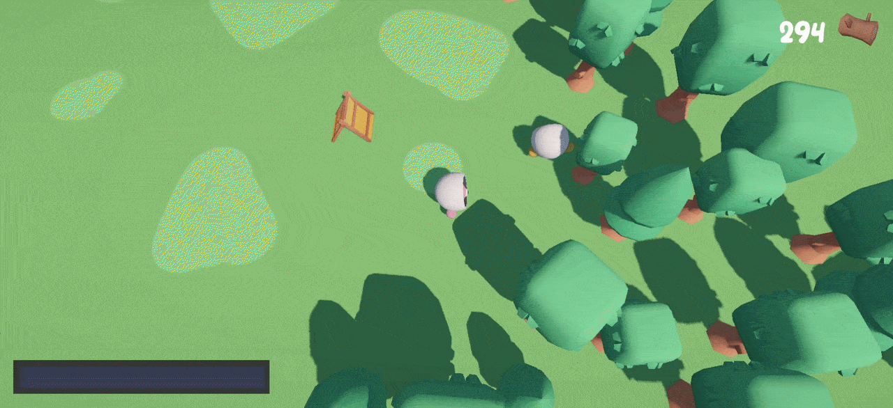

# Incremental Game Sample - PurrNet 🐱



A multiplayer incremental game sample built with **[PurrNet](https://github.com/PurrNet/PurrNet)** — the purrfect Unity networking solution.

Collect resources, dash through trees, suck up loot, upgrade your stats and race to the finish!
This sample is designed to show how PurrNet handles a full gameplay loop with minimal networking boilerplate.

📖 **[Full written (+ video) guide on the docs](https://purrnet.gitbook.io/docs/full-game-guides/incremental-game-sample)**

## What's Inside

This sample covers a complete multiplayer incremental game loop with simple polish (audio & visual), including:

- **Dash-to-harvest** — Dash through resources to break them and collect loot
- **Vacuum mechanic** — Suck up dropped loot and bring it back to your base
- **Upgrade system** — Spend wood on upgrades: movement speed, damage, dash distance, inventory space, wood per tree, and a win condition
- **Infinite-world feel** — Noise-based resource spawning around players with automatic cleanup
- **Object pooling** — Trees and loot use PurrNet's built-in pooling for performance
- **Networked audio** — Pooled network audio for tree chopping and other SFX
- **Networked state machine** — Player states (movement, dash, suck) synced automatically via PurrNet's plug-n-play state machine

## PurrNet Features Demonstrated

| Feature | Usage |
|---|---|
| [Network Manager](https://purrnet.gitbook.io/docs/systems-and-modules/network-manager) | Basic UDP setup with unsafe rules for quick iteration |
| [Network Transform](https://purrnet.gitbook.io/docs/plug-n-play-components/network-transform) | Owner-authed player movement sync |
| [State Machine](https://purrnet.gitbook.io/docs/plug-n-play-components/state-machine-auto-networked) | Auto-networked finite state machine for player states |
| [Object Pooling](https://purrnet.gitbook.io/docs/systems-and-modules/network-identity/pooling) | Pooled trees and loot for zero-alloc spawning |
| [Network Prefabs](https://purrnet.gitbook.io/docs/systems-and-modules/network-manager/network-prefabs) | Pre-configured prefab list in the Prefabs folder |
| [Network Assets](https://purrnet.gitbook.io/docs/systems-and-modules/network-manager/network-assets) | Audio clips registered for network playback |
| [Instance Handler](https://purrnet.gitbook.io/docs/systems-and-modules/instance-handler) | Used by UI views to communicate with game systems |
| [Ownership](https://purrnet.gitbook.io/docs/systems-and-modules/network-identity/ownership) | Loot and resources transfer ownership on interaction |

## Getting Started

### Requirements

- Unity (version TBD)
- [PurrNet](https://github.com/PurrNet/PurrNet)
- Cinemachine
- New Unity Input System

### Install

1. Clone or download this repository
2. Open the project in Unity
3. Open `Scenes/GameScene`
4. Press Play — you should see your player spawn, be able to run around, chop trees, suck up loot and dump it at your base

To test multiplayer, spin up a clone and connect!

## Project Structure

```
Assets/
├── Art/              # Visual assets (Kenney.nl) & audio
├── Prefabs/          # Network prefabs (player, trees, loot, etc.)
├── Scenes/           # GameScene
└── Scripts/          # All game logic
```

### Key Components

**Player** — Built on PurrNet's networked state machine with three states:
- **Movement** — Simple rigidbody movement (~100 lines including state handling)
- **Dash** — Directional dash that passes through resources, temporarily becoming a trigger collider
- **Suck** — Cone-based vacuum that takes ownership of loot, pulls it in with physics, and adds it to inventory

**Base** — Syncs the wood count, visually sucks loot from the player's inventory, and despawns it on contact.

**Resources** — Trees with synced health. Whoever hits a resource takes ownership and applies damage immediately for responsive feel regardless of host status. Drops loot on death based on player upgrades.

**Resource Spawner** — Noise-driven, layer-based spawner on the GameManager. Spawns resources around active players, cleans up when players leave the area, and respawns harvested resources after an interval. Frame-budgeted to avoid hitches.

**Upgrades** — Scriptable-based upgrade definitions populated through the `PlayerUpgrades` component. Easy to extend with new upgrade types.

## Scaling & Extending

The setup is built to be easy to scale on:

- **Upgrades** — Add new ScriptableObjects to define new upgrade types
- **Resources** — The spawner is layer-based and modular; add new resource types with different conditions and rarities
- **Player states** — Drop in new states to the state machine as needed

## Credits

- Visual assets by [Kenney.nl](https://kenney.nl)
- Networking by [PurrNet](https://purrnet.dev)

## Links

- 🐱 [PurrNet GitHub](https://github.com/PurrNet/PurrNet)
- 📖 [PurrNet Docs](https://purrnet.gitbook.io/docs)
- 💬 [Discord](https://discord.gg/HnNKdkq9ta)
- 📈 [Full Guide for this Sample](https://purrnet.gitbook.io/docs/full-game-guides/incremental-game-sample)

## License

MIT
